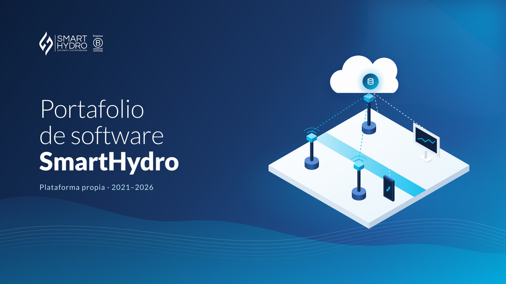
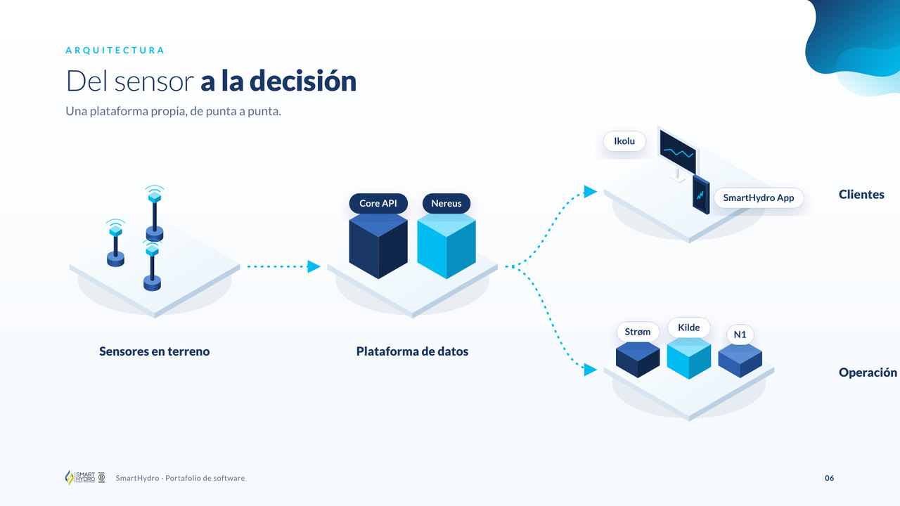
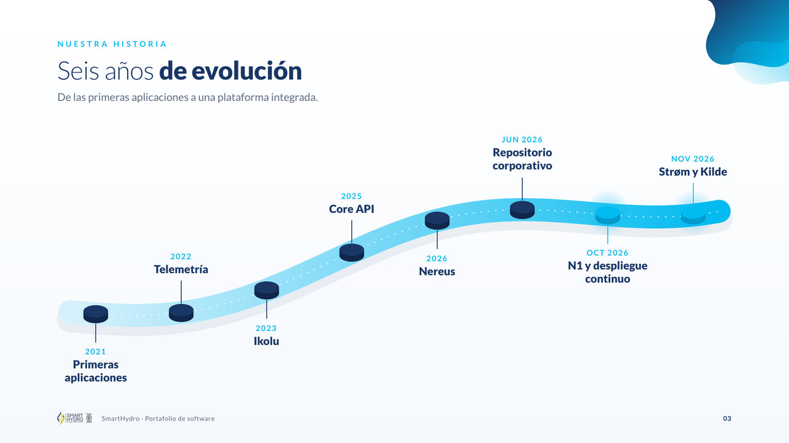
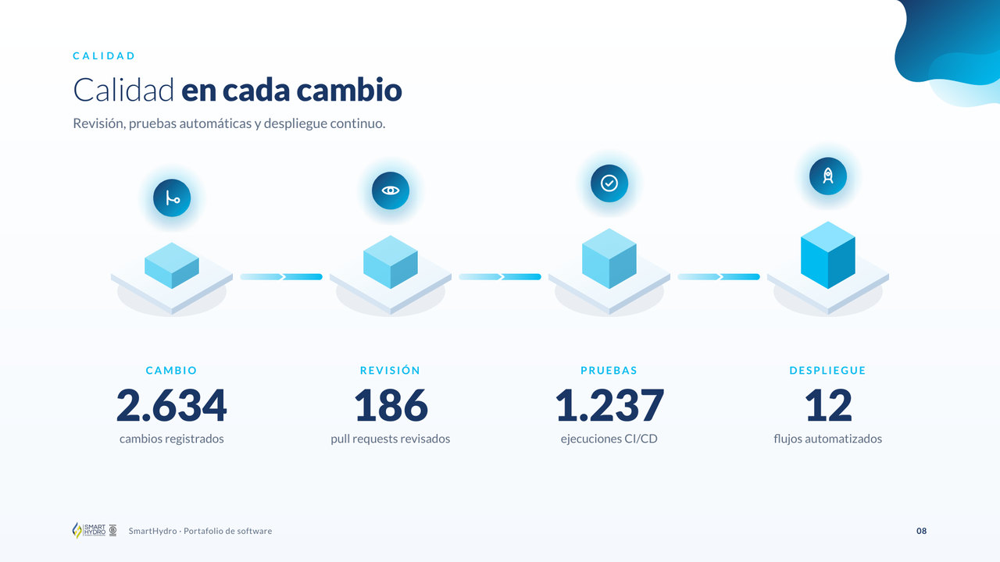

  

  <h1>SmartHydro</h1>

  
<strong>Monitoreo, telemetría y cumplimiento normativo para la gestión inteligente del agua</strong>

 

  

## Qué hacemos

**Monitoreo en tiempo real** &nbsp;·&nbsp; **Cumplimiento DGA y SMA** &nbsp;·&nbsp; **Alertas y reportes** &nbsp;·&nbsp; **Operación y servicio**

## Del sensor a la decisión

Una plataforma propia, de punta a punta.

  

## Productos

| Producto | Propósito |
|---|---|
| **Core API** | Datos, reportes y la base de la plataforma. |
| **Nereus** | Plataforma integrada de telemetría y operación. |
| **Ikolu** | Monitoreo web y cumplimiento normativo. |
| **SmartHydro App** | Monitoreo móvil de captaciones y alertas. |
| **Strøm** | Operación e instalaciones en terreno. |
| **Kilde** | Gestión comercial de ventas y clientes. |
| **N1** | Asistente de soporte. |

## Nuestra historia

Desde 2021, de las primeras aplicaciones a una plataforma integrada.

  

## Calidad

Desde 2021: **2.634** cambios versionados, **186** pull requests revisados y **1.237** ejecuciones de CI/CD.

  

 

  

  
<a href="https://smarthydro.cl">smarthydro.cl</a>

