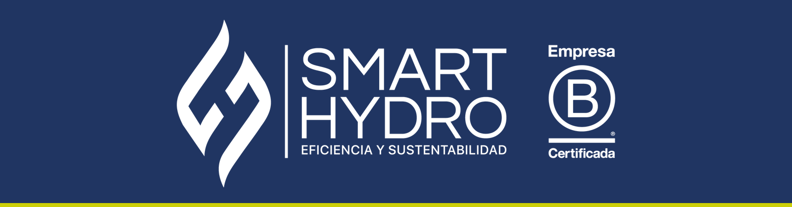

  

 

# SmartHydro

Telemetría de agua y monitoreo en Chile. Gestiona el cumplimiento de la normativa ante diferentes entidades, entre ellas la DGA y la SMA (Superintendencia del Medio Ambiente). Empresa B.

[smarthydro.cl](https://smarthydro.cl)

  
  
  
  

Los repositorios de producto de la empresa viven en esta organización.

## Marca

Paleta tomada de los tokens oficiales (`smarthydro.tokens.js` en `ui_ikolu`, extraídos de [smarthydro.cl](https://smarthydro.cl)):

| Color | Hex | Uso |
|---|---|---|
| Azul corporativo | `#203562` | Principal, encabezados, fondo de marca |
| Lima / acento | `#CCCF07` | Acento y destacados |
| Azul medio | `#3A68AA` | Apoyo |

## Productos

- **Ikolu** — ERP de operación: tickets, SLA, órdenes de trabajo y cumplimiento normativo ante entidades como la DGA y la SMA (`ikolu3`, `ui_ikolu`)
- **Nereus** — app nativa en Flutter y API de telemetría + ERP (`nereus_app`, `nereus_api`)
- **API de telemetría** — API de gestión de telemetría y clientes (`api`, `core_api_sh`, `api_telemetry_smarthydro`)
- **App de monitoreo** — app Flutter para Android y web/PWA (`smarthydro_app`)
- **Agentes** — agentes de IA para la operación (Njord, Mimir, Ran, Kolga), consola de escritorio y el agente N1 de Google Chat (`smarthydro_agents`, `agent_console`, `agent_desktop`, `smarthydro-n1`)

## Stack

  
  
  
  
  
  
  
  

